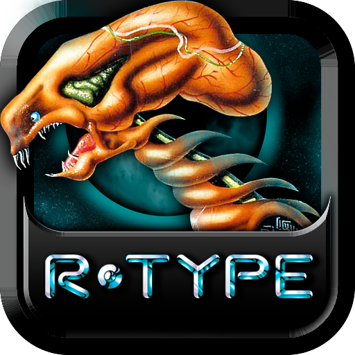

<p align="center">
  
  &nbsp;&nbsp;&nbsp;
  
</p>

<h1 align="center">R-Type</h1>

<p align="center">
  A networked multiplayer shoot 'em up built with the Gringo ECS engine.
</p>

<p align="center">
  <a href="https://github.com/Yoyott29/R-Type/actions/workflows/tests.yml">
    
  </a>
  <a href="LICENSE">
    
  </a>
  <a href="https://r-type-project-documentation.vercel.app/">
    
  </a>
</p>

## Presentation

### What is R-Type?

R-Type is a free and open-source reimplementation of the classic
side-scrolling shoot 'em up, developed as an Epitech project. The repository
contains three projects:

- **R-Type**: the multiplayer game. An authoritative server runs the game and
  up to four clients display it and send their inputs.
- **Gringo Engine**: a modular C++ ECS engine with an editor, runtime plugins,
  renderers, networking, physics, audio, and C++ gameplay scripts. R-Type is
  built on it, and the engine knows nothing about R-Type.
- **TrackNTrap**: a second game made with the same engine, to show that it is
  reusable: a 3D multiplayer race between rats.

The server owns the game state and communicates with up to four clients over
UDP. The client renders the game through the engine's raylib renderer plugin.

### Features

- Authoritative multiplayer gameplay for up to four players, with a lobby.
- UDP networking with configurable host and port.
- Entity Component System architecture.
- Runtime-loadable engine plugins and renderers.
- Gringo editor for creating engine projects and building their executables.
- 2D and 3D engine components, physics, audio, input, UI, and C++ gameplay
  scripts.
- Color-blind filters (protanopia, deuteranopia, tritanopia).
- Automated tests and continuous integration.

### Design goals

- **Modular**: use independent plugins for engine capabilities.
- **Data-oriented**: keep gameplay organised around ECS components and systems.
- **Extensible**: support new games, components, renderers, and network
  protocols without changing the engine core.
- **Playable**: provide a complete multiplayer R-Type experience, not only an
  engine prototype.

### Project status

This project is actively developed. Linux is the primary development
environment. Continuous integration builds and tests the project on both Linux
and Windows (MSVC), with the commands described below.

Supported platforms:

| Platform | Server | Client |
| --- | :---: | :---: |
| Linux | Yes | Yes |
| Windows | Yes | Yes |
| macOS | No | No |

## Dependencies

The project downloads its C++ dependencies with
[CPM.cmake](https://github.com/cpm-cmake/CPM.cmake) during configuration:

- [raylib](https://github.com/raysan5/raylib) 6.0 — client rendering.
- [Asio](https://github.com/chriskohlhoff/asio) 1.30.2 — standalone UDP
  networking.
- [miniaudio](https://github.com/mackron/miniaudio) 0.11.22 — audio.
- [nlohmann/json](https://github.com/nlohmann/json) 3.11.3 — JSON
  serialisation.

The engine also uses the platform thread and dynamic-loading libraries
provided by the operating system.

## Prerequisites

You need:

- A C++20 compiler.
- CMake 3.28 or newer.
- Git.
- An internet connection for the first CMake configuration, so CPM can fetch
  dependencies.

### Linux (Ubuntu/Debian)

Install the compiler, build tools, Git, CMake, and the libraries required by
raylib:

```sh
sudo apt update
sudo apt install build-essential cmake git \
  libgl1-mesa-dev libx11-dev libxrandr-dev libxi-dev \
  libxcursor-dev libxinerama-dev
```

Check the CMake version:

```sh
cmake --version
```

It must report version 3.28 or newer. On distributions with an older CMake,
install a current version from the
[official CMake downloads](https://cmake.org/download/) or with Snap:

```sh
sudo snap install cmake --classic
```

### Windows

#### 1. Install the C++ toolchain

Download and start the
[Visual Studio Build Tools installer](https://visualstudio.microsoft.com/downloads/).
In the **Workloads** tab, select:

- **Desktop development with C++**

In the installation details on the right, make sure these components are
selected:

- **MSVC C++ build tools** (the latest available version, such as MSVC v143).
- **Windows 10 or Windows 11 SDK**.
- **C++ CMake tools for Windows**.
- **Git for Windows** (optional if Git is installed separately).

Click **Install** and restart Windows if the installer requests it. The full
Visual Studio IDE is not required; the Build Tools package is enough.

#### 2. Install Git and CMake

Install [Git for Windows](https://git-scm.com/download/win) and
[CMake](https://cmake.org/download/) if they were not installed with the
Build Tools. When installing CMake, enable **Add CMake to the system PATH**.

With `winget`, Git and CMake can be installed from PowerShell:

```powershell
winget install Kitware.CMake
winget install Git.Git
```

#### 3. Use a developer terminal

The MSVC compiler is not always available in a regular PowerShell window.
Open one of the following from the Start menu:

- **Developer PowerShell for VS 2022**
- **x64 Native Tools Command Prompt for VS 2022**

These terminals configure `cl.exe`, the Windows SDK, and the linker
automatically. If you installed a different Visual Studio version, use the
matching terminal name.

Verify the installation:

```powershell
cl
cmake --version
git --version
```

The `cl` command should print the Microsoft C/C++ compiler version, and CMake
must report version 3.28 or newer. If `cl` is not recognised, close the
terminal and reopen the Visual Studio developer terminal rather than using a
regular PowerShell window.

#### 4. Configure and build

From the repository root, run:

```powershell
cmake -S . -B build -A x64
cmake --build build --config Release --target r-type_client r-type_server
```

`r-type_server.exe` and `r-type_client.exe` are placed in the repository root,
like on Linux. The game finds its files from the location of the executable,
so you can start it from any folder:

```powershell
.\r-type_server.exe
.\r-type_client.exe
```

The `.sh` scripts can also be run from Git Bash.

## Launch

Run the commands below from the repository root.

### Build R-Type

The project-provided script configures the root CMake project and builds both
mandatory executables:

```sh
./build_rtype.sh
```

The first run downloads the dependencies listed above. The resulting
executables, `r-type_server` and `r-type_client`, are placed in the repository
root.

### Start a game

Start the server in one terminal:

```sh
./r-type_server
```

Start one client per player in separate terminals:

```sh
./r-type_client
```

Start the server first: a client tries to connect for about 5 seconds, then
quits if no server answers.

Both programs use `127.0.0.1:4242` by default, so the server only accepts
clients from the same machine. Give a single argument to change the port, or an
IPv4 address and a port. The client and the server must use the same port:

```sh
./r-type_server 5000                 # listens on 127.0.0.1:5000
./r-type_client 5000                 # joins 127.0.0.1:5000
```

To play over a network, start the server on `0.0.0.0` (every network
interface) and give the clients the IP address of the machine running the
server (`192.168.1.20` below is an example):

```sh
./r-type_server 0.0.0.0 4242
./r-type_client 192.168.1.20 4242
```

On Windows, run `r-type_server.exe` and `r-type_client.exe` from PowerShell,
or run the commands above from Git Bash.

How to play (lobby, controls, gameplay) is explained in the
[user documentation](https://r-type-project-documentation.vercel.app/user/getting-started).

### Run tests

On Linux, run the project test suite with:

```sh
./tests/tests.sh
```

It builds the project, then starts the real server and client to check their
arguments, logs, connection and shutdown.

The engine unit tests (scheduler, thread pool, network protocol...) are built
separately:

```sh
cmake -S "Gringo Engine" -B build-unit -DGRINGO_BUILD_TESTS=ON
cmake --build build-unit --target engine_tests network_tests
ctest --test-dir build-unit --output-on-failure
```

### Simulate a bad network

`tests/netlag.sh` and `tests/netloss.sh` are not tests: they add latency or
packet loss to the game port on localhost while you play, until you press
Ctrl+C. They are Linux only, need `sudo`, and use `tc` (package `iproute2`):

```sh
./tests/netlag.sh 100 20 4242        # 100 ms delay, 20 ms jitter, port 4242
./tests/netloss.sh 20 4242           # 20% packet loss on port 4242
```

## Gringo Engine and editor

Build the standalone engine and its editor with:

```sh
./Gringo\ Engine/build_engine.sh
```

This creates the editor, `Gringo Engine/Gringo`, with the engine library and
its plugins next to it. Start it to create or open a project (a `.gringo`
file), add entities and prefabs, set their components, choose the project's
plugins, and build the project:

```sh
./Gringo\ Engine/Gringo
```

The editor can also build a project from the command line. It generates the
project's `client_main.cpp` and `server_main.cpp`, then compiles them:

```sh
./Gringo\ Engine/Gringo --build R-Type/R-Type.gringo
```

Run this after changing `R-Type/R-Type.gringo` or adding a script, then
rebuild R-Type with `./build_rtype.sh`.

## TrackNTrap, the second game

TrackNTrap is a 3D race for up to four players, made with the same engine to
show that it is not tied to R-Type. Rats race around a kitchen track full of
knives, brooms, and spatulas, and drop mouse traps on the track for the others.
It lives in `Gringo Engine/TrackNTrap/`.

Build it with the editor (build the editor first, see above):

```sh
./Gringo\ Engine/Gringo --build "Gringo Engine/TrackNTrap/TrackNTrap.gringo"
```

This creates `trackntrap_server` and `trackntrap_client` in
`Gringo Engine/TrackNTrap/`. They take the same `[ip] [port]` arguments as
R-Type:

```sh
./Gringo\ Engine/TrackNTrap/trackntrap_server
./Gringo\ Engine/TrackNTrap/trackntrap_client
```

## Repository layout

```text
R-Type/                     R-Type game: .gringo scene, scripts, assets
Gringo Engine/              Standalone engine, with its own CMake project
├── src/                    ECS core, editor, plugins, renderers
├── tests/                  Engine unit tests
├── TrackNTrap/             Second game made with the engine
└── build_engine.sh         Builds the engine and the editor
Documentation/R-Type/       SvelteKit documentation website
tests/                      Test suite and network simulation scripts
Norms/                      clang-format and clang-tidy configuration
Developer Setup/            Script to set up a development machine
.github/                    CI workflows, templates, contribution guides
build_rtype.sh              Builds the R-Type client and server
```

## Documentation

The complete user and developer documentation is available on the
[R-Type documentation website](https://r-type-project-documentation.vercel.app/).

Useful sections:

- [Getting started](https://r-type-project-documentation.vercel.app/user/getting-started)
- [Controls](https://r-type-project-documentation.vercel.app/user/controls)
- [Multiplayer](https://r-type-project-documentation.vercel.app/user/multiplayer)
- [Architecture](https://r-type-project-documentation.vercel.app/developer/architecture)
- [Developer setup](https://r-type-project-documentation.vercel.app/developer/developer-setup)
- [Network protocol](https://r-type-project-documentation.vercel.app/developer/protocol)
- [Running tests](https://r-type-project-documentation.vercel.app/developer/running-tests)

The documentation website source is in
[Documentation/R-Type](Documentation/R-Type/). To run it locally, use
Node.js 20.19 or newer (or 22.12 or newer):

```sh
cd Documentation/R-Type
npm install
npm run dev
```

## License, contributors, and community

This project is distributed under the [MIT License](LICENSE).

### Contributing

Contributions, bug reports, documentation improvements, and gameplay ideas are
welcome. Before contributing:

1. Read the [contribution guide](.github/CONTRIBUTING.md).
2. Read the [Code of Conduct](.github/CODE_OF_CONDUCT.md).
3. Run the relevant build and tests locally.
4. Open an issue or pull request using the repository templates.

Security issues must be reported according to the
[Security Policy](.github/SECURITY.md), not through a public issue.

### Community resources

- [Issues](https://github.com/Yoyott29/R-Type/issues) — bug reports and
  feature requests.
- [Pull requests](https://github.com/Yoyott29/R-Type/pulls) — proposed changes.
- [Contributing guide](.github/CONTRIBUTING.md) — development workflow.
- [Security policy](.github/SECURITY.md) — private vulnerability reporting.

## Authors

| Name | Role | Contact |
| --- | --- | --- |
| Eliott Duchene | Engine and game | eliott1.duchene@epitech.eu |
| Arthur Vignes | Engine and game | arthur.vignes@epitech.eu |
| Clovis Nedelec | Network | clovis.nedelec@epitech.eu |
| Arthur Piron | Network | arthur.piron@epitech.eu |

Source code and issue tracking are hosted on
[GitHub](https://github.com/Yoyott29/R-Type).
