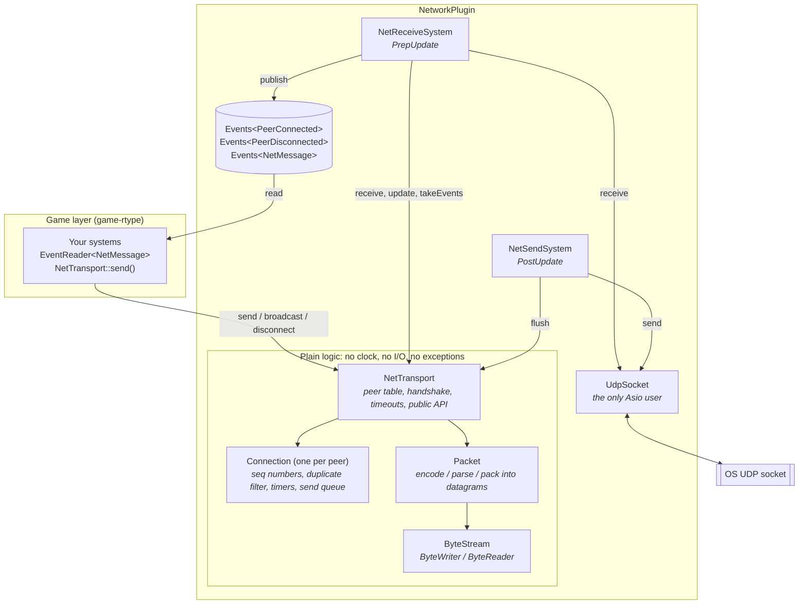
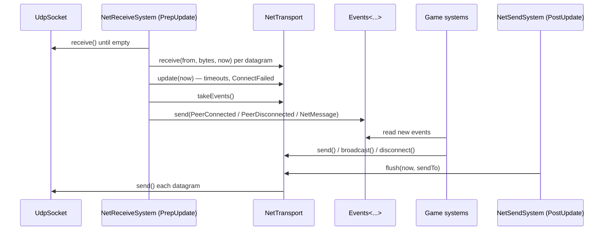
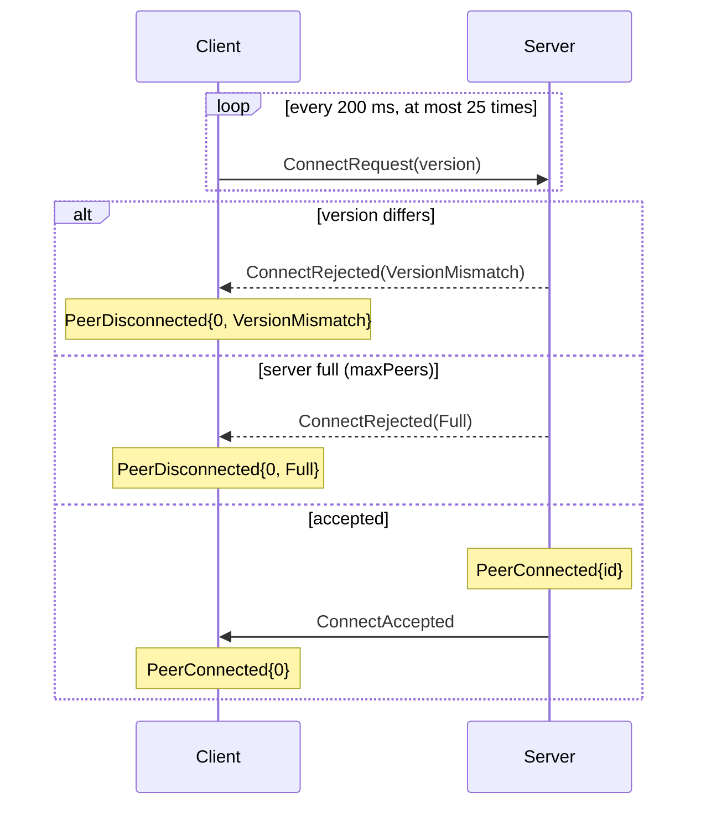

# NetworkPlugin

A small UDP networking plugin for the engine. It does three things:

1. **Connects peers.** A client connects to one server. A server accepts up to `maxPeers` clients.
2. **Carries messages.** A message is a `u16` type plus up to 1191 bytes of payload. The plugin never looks inside it.
3. **Reports what happened.** Connections, disconnections and incoming messages arrive as ECS events.

It knows nothing about the game. Message types, entity ids, ticks and inputs all belong to the game layer (`src/engine/game-rtype/`).

> **Delivery is unreliable.** Every message is sent once. It may be lost or arrive out of order. The plugin only drops duplicate and very old packets. If something must arrive, the game has to send it again. For example, the R-Type server sends a full snapshot every tick.

---

## Contents

1. [Quick start](#1-quick-start)
2. [How it fits together](#2-how-it-fits-together)
3. [One frame, step by step](#3-one-frame-step-by-step)
4. [Connection lifecycle](#4-connection-lifecycle)
5. [Delivery rules](#5-delivery-rules)
6. [Wire format](#6-wire-format)
7. [API reference](#7-api-reference)
8. [Configuration](#8-configuration)
9. [Errors](#9-errors)
10. [Gotchas](#10-gotchas)
11. [File map](#11-file-map)

---

## 1. Quick start

### Add the plugin

The same plugin serves both sides. The config decides the role.

```cpp
#include "NetworkPlugin.hpp"

// server: listen on 0.0.0.0:4242
app.addPlugin(std::make_shared<NetworkPlugin>(NetworkConfig::server(4242)));
// client: connect to 127.0.0.1:4242
app.addPlugin(std::make_shared<NetworkPlugin>(NetworkConfig::client("127.0.0.1", 4242)));
```

Add it **before** the game plugin. That way the game systems run after `NetReceiveSystem` in `PrepUpdate`, and they see this frame's events (see `src/main.cpp` and `src/engine/server/main.cpp`).

`build()` opens the socket. It **throws `NetError`** if the host can't be resolved or the port can't be bound, so the binary refuses to start. No other part of the plugin throws.

### Send a message

You choose the message types. The plugin only carries the `u16`.

```cpp
#include "ByteStream.hpp"
#include "NetTransport.hpp"

enum class Msg : std::uint16_t { Input = 1, Spawn = 2 };

ByteWriter w;
w.write<std::uint32_t>(tick);
w.write<std::uint16_t>(buttons);
std::vector<std::byte> bytes = w.take();

auto &net = scene.getResource<NetTransport>();
net.send(0, static_cast<std::uint16_t>(Msg::Input), bytes);    // client: the server is always PeerId 0
net.broadcast(static_cast<std::uint16_t>(Msg::Spawn), bytes);  // server: every connected peer
```

`send()` only queues the message. It goes out at the end of the frame, in `PostUpdate`.

### Receive messages and events

Read the incoming traffic with an `EventReader<T>`. Keep one as a member of your system.

```cpp
#include "ByteStream.hpp"
#include "Events.hpp"
#include "NetEvents.hpp"

class NetInbox : public System
{
  public:
    void update(Scene &scene) override
    {
        _joined.read(scene, [&](PeerConnected const &e) { /* say hello to e.peer */ });
        _left.read(scene, [&](PeerDisconnected const &e) { /* forget e.peer, see e.reason */ });
        _messages.read(scene, [&](NetMessage const &m) {
            try {
                ByteReader r{m.payload};
                switch (static_cast<Msg>(m.type)) {
                case Msg::Input: { auto tick = r.read<std::uint32_t>(); /* ... */ break; }
                default: break; // unknown type: ignore it
                }
            } catch (NetError const &) {
                // payload too short: a bad or hostile peer, drop the message
            }
        });
    }

  private:
    EventReader<PeerConnected> _joined;
    EventReader<PeerDisconnected> _left;
    EventReader<NetMessage> _messages;
};

scene.registerSystem<NetInbox>(PrepUpdate); // or Update, never FixedUpdate (see §11)
```

The payload comes from the network, so treat it as untrusted. `ByteReader` checks the bounds on every read and throws `NetError` instead of reading past the end.

---

## 2. How it fits together

Everything above the socket is **plain logic**. It reads no clock, does no I/O and never throws. The two systems pass in the current time and the real socket. That is why the tests can drive it with a fake clock and an in-memory network.



| Piece | Kind | Job |
|---|---|---|
| `NetworkPlugin` | `IPlugin` | Adds the resources and systems below in `build()`. Says goodbye to every peer in `cleanup()`. |
| `UdpSocket` | resource | Non-blocking IPv4 UDP socket. Hides Asio behind a pimpl. |
| `NetTransport` | resource | The public API. Owns the peers, runs the handshake and timeouts, and queues the events. |
| `Connection` | inside `NetTransport` | Per-peer state: outgoing sequence number, duplicate filter, last send/receive times, queued messages. |
| `Packet` | free functions | Turns a `Packet` into bytes and back. Groups messages into datagrams. |
| `ByteWriter` / `ByteReader` | helpers | Little-endian encoding. Also used by the game for its payloads. |
| `NetReceiveSystem` | `PrepUpdate` | Reads the socket, then turns transport events into ECS events. |
| `NetSendSystem` | `PostUpdate` | Sends everything queued during the frame. |

---

## 3. One frame, step by step



1. **PrepUpdate: `EventUpdateSystem<...>`** rotates the three event buffers. An event lives for two frames, so each reader sees it once.
2. **PrepUpdate: `NetReceiveSystem`**
   - Reads every pending datagram (1500-byte buffer) and hands it to `NetTransport::receive`. Bad datagrams are dropped without a word.
   - Calls `NetTransport::update(now)`, which ends peers that went silent and gives up a client handshake that took too long.
   - Moves the transport's events into the ECS `Events<T>` resources.
3. **Your systems** read the events and call `send()` / `broadcast()` / `disconnect()`.
4. **PostUpdate: `NetSendSystem`** calls `NetTransport::flush(now, ...)`. For each peer, in order, it sends:
   1. a `ConnectRequest` (client still connecting, if a retry is due),
   2. queued control packets (`ConnectRejected`, `Disconnect`),
   3. a `ConnectAccepted` (server, if one is owed),
   4. all queued messages, packed into as few `Data` datagrams as possible,
   5. a `KeepAlive`, if nothing was sent to that peer for `keepAliveInterval`.

---

## 4. Connection lifecycle

### Peer ids

- **Client:** the server is always `PeerId 0`.
- **Server:** clients get `1, 2, 3, …` in the order they connect. Ids are never reused.

### Handshake



- The server emits `PeerConnected` as soon as it accepts the request. The client emits it when `ConnectAccepted` arrives.
- If `ConnectAccepted` is lost, the client's next `ConnectRequest` makes the server send it again.
- If 25 attempts get no answer, the client emits `PeerDisconnected{0, ConnectFailed}` one retry interval after the last one, about 5 s in total.
- While a client is connecting, `send(0, …)` does nothing and incoming `Data` is ignored.

### Staying alive

- Any packet a peer sends (`Data`, `KeepAlive`, …) keeps it alive.
- If nothing was sent to a peer for `keepAliveInterval` (250 ms), a `KeepAlive` goes out. So an idle link still shows signs of life.
- If nothing is received from a peer for `timeout` (5 s), it gets `PeerDisconnected{peer, Timeout}`.

### Ending

| How | What the other side sees | Local event? |
|---|---|---|
| `disconnect(peer)` | `Disconnect` sent `disconnectRedundancy` (3) times → `PeerDisconnected{…, Remote}` | **No.** You asked for it, so you already know. |
| Peer goes silent | — | `PeerDisconnected{peer, Timeout}` |
| Remote sends `Disconnect` | — | `PeerDisconnected{peer, Remote}` |
| App shuts down | `NetworkPlugin::cleanup()` disconnects every peer and sends at once → `Remote` | No |

`disconnect()` also throws away any messages still queued for that peer.

**A client's session is final.** Once a client reaches `Disconnected`, for any reason, it stays there. To reconnect, build a new `NetTransport` (in practice, a new app).

---

## 5. Delivery rules

| Guarantee | Yes / No |
|---|---|
| Messages arrive | **No.** Each message is sent once. Lost means lost. |
| Messages arrive in order | **No.** Packets can be reordered. Messages inside one datagram keep their order. |
| No duplicates | **Yes.** A packet already received is dropped. |
| Messages arrive whole | **Yes.** A message is never split across datagrams, and a bad datagram is dropped entirely. |
| Stale packets dropped | **Yes**, but only those more than 32 packets behind the newest one received. |

### How duplicates are caught

Every packet sent to a peer gets the next `u16` sequence number for that peer. On receive, `Connection` remembers the newest `seq` and keeps a 32-bit mask of which of the 32 earlier ones it has already seen:

- **newer than the newest** → accepted, the window slides forward,
- **within 32 behind and not seen yet** → accepted (reordered packet),
- **already seen, or more than 32 behind** → dropped.

Sequence numbers wrap around at 65535. `seqNewer(a, b)` compares them correctly across the wrap.

### Packing

All messages queued for a peer during one frame are packed into as few `Data` datagrams as possible (**first-fit**, `packMessages`). The cap is 1200 bytes per datagram. Messages keep their queue order inside each datagram.

---

## 6. Wire format

All integers are **little-endian**. A datagram is at most **1200 bytes**. There is no fragmentation.

### Packet header (5 bytes)

| Offset | Size | Field | Notes |
|---:|---:|---|---|
| 0 | 2 | `protocolId` | always `0x5254` ("RT"); on the wire: `54 52` |
| 2 | 1 | `kind` | see below |
| 3 | 2 | `seq` | per-peer packet counter |

### Kinds and bodies

| `kind` | Value | Body | Sent by |
|---|---:|---|---|
| `Data` | 0 | 0..N messages | both |
| `ConnectRequest` | 1 | `version u16` | client |
| `ConnectAccepted` | 2 | *(empty)* | server |
| `ConnectRejected` | 3 | `reason u8` (`0` Full, `1` VersionMismatch) | server |
| `KeepAlive` | 4 | *(empty)* | both |
| `Disconnect` | 5 | *(empty)* | both |

### Message (inside `Data`, repeated until the end of the datagram)

| Size | Field | Notes |
|---:|---|---|
| 2 | `type` | yours, never read by the plugin |
| 2 | `len` | payload size in bytes |
| `len` | payload | |

### Size budget

```
1200  datagram
-  5  packet header
-  4  message header
= 1191 bytes max payload   (MAX_PAYLOAD in Packet.hpp)
```

### Example: one 3-byte message

```
54 52 | 00 | 07 00 | 02 00 | 03 00 | AA BB CC
 id   kind  seq=7   type=2   len=3   payload
```

### What gets dropped

A datagram is **silently dropped** if:

- it is shorter than 5 bytes or longer than 1200 bytes,
- `protocolId` doesn't match,
- `kind` or `reason` is out of range,
- a control body has the wrong length, or a message runs past the end of the datagram,
- it is a duplicate or too old (§5),
- it is not expected in the current state: anything from an unknown address except a `ConnectRequest`, anything a client receives from an address other than its server, …

**Versioning** goes through `ConnectRequest::version`, never through `protocolId`. When the game changes a message format, it bumps `NetworkConfig::protocolVersion`. Old clients then get `VersionMismatch` instead of garbage.

---

## 7. API reference

### `NetTransport` (scene resource)

```cpp
auto &net = scene.getResource<NetTransport>();
```

| Call | Behaviour |
|---|---|
| `send(peer, type, payload)` | Queues one message for the next flush. Unknown or not-yet-connected peer: does nothing. Payload over `MAX_PAYLOAD` (1191): dropped, logged once to `stderr`. |
| `broadcast(type, payload)` | `send()` to every peer connected **at the time of the call**. |
| `disconnect(peer)` | Queues `Disconnect` ×3, drops that peer's queued messages and removes it. No local event. On a client, `disconnect(0)` also abandons a handshake in progress. |
| `peers()` | Ids of connected peers, sorted. |
| `state()` | Client: `Connecting`, `Connected` or `Disconnected`. Server: always `Connected`. |

`receive`, `update`, `flush` and `takeEvents` are also public, but the two plugin systems (and the tests) call them. Don't call them from game code.

> A `send()` to a peer that just left is normal. It can happen before your system has read the `PeerDisconnected` event. It does nothing and does no harm.

### Events (`ressources/NetEvents.hpp`)

```cpp
using PeerId = std::uint32_t;
enum class DisconnectReason { Timeout, Remote, ConnectFailed, Full, VersionMismatch };

struct PeerConnected    { PeerId peer; };
struct PeerDisconnected { PeerId peer; DisconnectReason reason; };
struct NetMessage       { PeerId peer; std::uint16_t type; std::vector<std::byte> payload; };
```

| `DisconnectReason` | Meaning | Side |
|---|---|---|
| `Timeout` | nothing received for `timeout` | both |
| `Remote` | the other side sent `Disconnect` | both |
| `ConnectFailed` | the server never answered the handshake | client |
| `Full` | the server already has `maxPeers` clients | client |
| `VersionMismatch` | `protocolVersion` differs | client |

Only `NetReceiveSystem` emits these events. Control packets (`ConnectRequest`, `KeepAlive`, …) never show up as `NetMessage`.

### `ByteWriter` / `ByteReader` (`ByteStream.hpp`)

| | `ByteWriter` | `ByteReader` |
|---|---|---|
| Numbers, `bool`, enums | `write<T>(value)` | `read<T>()` |
| String (`u16` length + bytes) | `write(std::string)`, throws `NetError` if over 65535 bytes | `readString()` |
| Raw bytes | `write(std::span<const std::byte>)` | `readBytes(n)` |
| Other | `reserve(n)`, `take()` | `remaining()` |

Everything is little-endian on any host. Floats are copied bit for bit. `ByteReader` throws `NetError` on any read past the end.

---

## 8. Configuration

`NetworkConfig` (`NetworkConfig.hpp`). Use `NetworkConfig::server(port, host = "0.0.0.0")` or `NetworkConfig::client(host, port)`, then change fields if needed.

| Field | Default | Used by | Meaning |
|---|---|---|---|
| `role` | `Server` | both | set by the factory |
| `host` | — | both | server: IPv4 address to bind; client: server name or IPv4 (resolved once) |
| `port` | — | both | server: port to bind (`0` = any free port); client: server port |
| `protocolVersion` | `1` | both | must match on both sides |
| `maxPeers` | `4` | server | clients accepted at once |
| `connectAttempts` | `25` | client | `ConnectRequest`s before giving up |
| `connectRetryInterval` | `200 ms` | client | delay between attempts |
| `keepAliveInterval` | `250 ms` | both | send a `KeepAlive` after this much silence |
| `timeout` | `5000 ms` | both | drop a peer after this much silence |
| `disconnectRedundancy` | `3` | both | copies of `Disconnect` sent, in case some are lost |
| `logStats` | `true` | both | every second, log each peer's incoming packets/s, loss %, late and duplicate packets to stderr. Loss is measured from `seq` gaps, so each side only sees what it receives. |

The client binds a random local port and sends only to the resolved server address.

---

## 9. Errors

| Where | What happens |
|---|---|
| `build()`: bad host, failed resolve or bind | throws `NetError`. This is the only throw in the plugin. |
| Bad / unexpected datagram | dropped silently |
| `send()` payload too big | dropped, logged once |
| Socket send/receive error | skipped, logged once per direction. ICMP "connection refused" from a closed port is ignored. |
| `ByteReader` past the end (your payload parsing) | throws `NetError`. Catch it in your handler. |

`NetError` derives from `EngineError`.

---

## 10. Gotchas

- **Read events in `PrepUpdate` or `Update`, not `FixedUpdate`.** An event lives for two frames. `FixedUpdate` can run zero times in a frame, so a reader there can miss events.
- **Register game systems after the plugin.** `NetReceiveSystem` must run before your readers in `PrepUpdate`. Otherwise they see the events one frame late.
- **Sends are not instant.** Everything goes out in `PostUpdate`. Calling `send()` twice in a frame puts both messages in the same datagram when they fit.
- **Nothing is resent.** Design messages so that losing one is fine (send state, not deltas), or resend them yourself.
- **The server emits `PeerConnected` before the client knows it's in.** A reply sent from that event (e.g. a Welcome) leaves in the same flush, in the datagram right after `ConnectAccepted`. If the accept is lost or overtaken, the client drops the reply as "data before accept". A message that must arrive should be sent again until the client shows it got it (e.g. its first input).
- **`PeerId 0` means "the server" on a client.** On a server, 0 is never a valid id.
- **One `NetTransport` per scene.** The plugin registers its resources on `app._scene`.

---

## 11. File map

```
Network/
├── NetworkPlugin.hpp/.cpp      IPlugin: build() wires everything, cleanup() says goodbye
├── NetworkConfig.hpp           NetworkConfig, NetRole, NetClock / TimePoint
├── ByteStream.hpp              ByteWriter, ByteReader, NetError
├── Packet.hpp/.cpp             wire constants, Packet, writePacket / parsePacket / packMessages
├── Connection.hpp/.cpp         per-peer seq, duplicate filter, timers, send queue
├── ressources/
│   ├── NetEvents.hpp           PeerId, PeerConnected, PeerDisconnected, NetMessage
│   ├── NetTransport.hpp/.cpp   public API, peer table, handshake, lifecycle
│   └── UdpSocket.hpp/.cpp      Endpoint, non-blocking Asio socket (pimpl)
└── systems/
    ├── NetReceiveSystem.hpp/.cpp   socket → transport → Events (PrepUpdate)
    └── NetSendSystem.hpp/.cpp      transport → socket (PostUpdate), flushToSocket()
```
